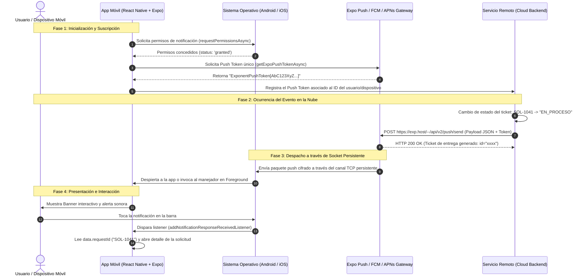
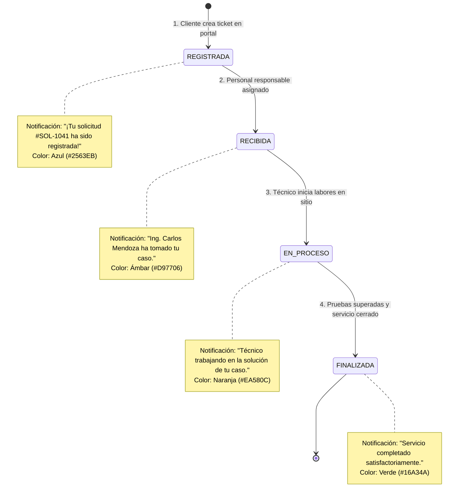

# Reporte de Entrega: Actividad 21
## Integración de un Servicio de Notificaciones Push a una Aplicación Móvil
### Caso de Estudio: Aplicación Móvil de Seguimiento de Solicitudes de Servicio

---

## 1. Portada y Ficha Técnica

| Parámetro | Detalle Técnico |
| :--- | :--- |
| **Actividad** | Actividad 21 - Integración de Servicio de Notificaciones Push |
| **Asignatura** | Desarrollo de Aplicaciones Móviles / Ingeniería Móvil |
| **Caso de Estudio** | Sistema de Seguimiento y Trazabilidad de Solicitudes Técnicas |
| **Framework Móvil** | React Native (v0.88.1) con Expo SDK (v58) |
| **Librería Push** | `expo-notifications`, `expo-device`, `expo-constants` |
| **Servicio de Notificación** | Expo Push Notification Gateway (retransmitido vía FCM en Android y APNs en iOS) |
| **Servicio Remoto / Backend** | Servidor Node.js (Express/REST) + Panel Web + Script CLI (`send-push.js`) |
| **Mecanismo de Comunicación** | Disparo asíncrono HTTP/2 REST ➔ Socket TCP persistente del Sistema Operativo |
| **Fecha de Elaboración** | Noviembre 2026 |

---

## 2. Definición del Problema a Resolver

### ¿Cómo puede una aplicación móvil recibir información de un servicio en la nube sin que el usuario tenga que consultar manualmente la aplicación?

Tradicionalmente, para que una aplicación móvil refleje cambios ocurridos en un servidor remoto, se solía recurrir al **Sondeo Periódico (HTTP Polling)**, donde la aplicación realiza solicitudes `GET` cíclicas (por ejemplo, cada 30 segundos) para preguntar: *¿Ha cambiado el estado de mi solicitud?*

Este modelo presenta deficiencias críticas:
1. **Consumo excesivo de batería:** Mantiene la antena de radio (Wi-Fi/Móvil) en estado activo permanente, impidiendo que el dispositivo entre en modo de bajo consumo (*Doze Mode* en Android).
2. **Desperdicio de ancho de banda y cuota de datos:** La gran mayoría de las peticiones responden con `304 Not Modified` o con los mismos datos inalterados.
3. **Sobrecarga del servidor:** Con miles de usuarios concurrentes, el servidor recibe millones de peticiones innecesarias.
4. **Latencia en la información:** Si una solicitud finaliza en el segundo 1, pero el intervalo de sondeo es de 60 segundos, el usuario no se enterará sino hasta 59 segundos después.

### La Solución: Notificaciones Push Asíncronas
La solución óptima consiste en **invertir el flujo de control** mediante una arquitectura orientada a eventos (*Event-Driven Architecture*):
- El dispositivo móvil **no sondea** al servidor.
- El sistema operativo (Android / iOS) mantiene una **única conexión de socket TCP persistente de bajo consumo** con la infraestructura central de Google (FCM) o Apple (APNs).
- Cuando el servidor remoto detecta un cambio de estado en el backend (ej. una solicitud pasa de `RECIBIDA` a `EN_PROCESO`), el servidor despacha un mensaje push hacia el **Gateway de Notificaciones**.
- El Gateway envía el paquete a través del canal persistente hacia el dispositivo móvil, el cual "despierta" a la aplicación o muestra la alerta en la barra de notificaciones del sistema de forma **inmediata**, con **cero consumo de batería en espera** y **cero consultas innecesarias**.

---

## 3. Diagramas de Arquitectura y Comunicación

### Diagrama 1: Flujo de Comunicación Servidor en la Nube ➔ Dispositivo Móvil



---

### Diagrama 2: Máquina de Estados del Caso de Estudio



---

## 4. Desarrollo de las Partes de la Práctica

### Parte 1. Preparación del Proyecto y Servicio

#### 1. Selección del Proyecto
Se construyó una aplicación moderna con **React Native** y **Expo SDK**, estructurada en módulos de presentación y servicios independientes dentro del directorio `src/`.

#### 2. Investigación de Servicios de Notificaciones Disponibles

| Servicio | Plataforma | Ventajas Principales | Desventajas / Limitaciones |
| :--- | :--- | :--- | :--- |
| **Expo Push Notifications** | Android, iOS, Web | API REST unificada, sin necesidad de compilar código nativo en fase de prototipado, soporte automático de tokens multiplataforma. | Depende del gateway de Expo como puente hacia FCM/APNs. |
| **Firebase Cloud Messaging (FCM)** | Android, iOS, Web | Servicio nativo estándar de Google, gratuito, altamente escalable, soporte de topics y analytics. | Requiere configuración de `google-services.json`, certificados APNs para iOS y manejo de SDKs nativos. |
| **Apple Push Notification (APNs)** | Exclusivo iOS/macOS | Canal oficial y obligatorio para el ecosistema Apple, máxima eficiencia y prioridad en iOS. | No funciona en Android; requiere cuenta de desarrollador Apple de pago ($99 USD/año) y certificados `.p8`/`.p12`. |
| **OneSignal** | Multiplataforma | Panel web administrativo muy completo, segmentación avanzada de usuarios, pruebas A/B. | Modelo freemium; requiere SDK propietario adicional. |

#### 3. Alternativa Seleccionada y Justificación
Se seleccionó **Expo Push Notifications** debido a:
- Permite implementar un prototipo 100% funcional y probado en dispositivos reales (Android e iOS) a través del cliente oficial de **Expo Go**.
- Provee un endpoint HTTP/2 estándar (`https://exp.host/--/api/v2/push/send`) al que cualquier servicio remoto o backend en Node.js, Python, Java o PHP puede despachar notificaciones con una simple llamada `fetch` o `curl`.
- Abstrae la complejidad de lidiar con las diferencias de protocolo entre FCM (Google) y APNs (Apple).

#### 4. Configuración del Proyecto
Se instalaron las dependencias esenciales:
- `expo-notifications`: Manejador de listeners, canales Android, badges y notificaciones programadas.
- `expo-device`: Detección de dispositivos físicos vs simuladores.
- `expo-constants`: Lectura de metadatos y Project IDs de Expo Application Services (EAS).

En `app.json` se definieron los permisos y el plugin oficial:
```json
"plugins": [
  [
    "expo-notifications",
    {
      "icon": "./assets/icon.png",
      "color": "#2563EB"
    }
  ]
],
"android": {
  "permissions": ["RECEIVE_BOOT_COMPLETED", "VIBRATE"]
}
```

---

### Parte 2. Implementación de Recepción de Notificaciones

La lógica se encuentra centralizada en `src/services/notificationService.js` y `App.js`.

#### 1. Solicitud de Permisos
```javascript
const { status: existingStatus } = await Notifications.getPermissionsAsync();
let finalStatus = existingStatus;
if (existingStatus !== 'granted') {
  const { status } = await Notifications.requestPermissionsAsync();
  finalStatus = status;
}
```

#### 2. Configuración de Canales para Android (Android 8.0 Oreo en adelante)
En Android es mandatorio asociar cada notificación a un canal de notificación con nivel de importancia:
```javascript
if (Platform.OS === 'android') {
  await Notifications.setNotificationChannelAsync('solicitudes_status', {
    name: 'Cambios de Estado de Solicitudes',
    importance: Notifications.AndroidImportance.MAX,
    vibrationPattern: [0, 250, 250, 250],
    lightColor: '#2563EB',
    sound: 'default',
    enableLights: true,
    enableVibrate: true,
    showBadge: true,
  });
}
```

#### 3. Obtención del Push Token
```javascript
const pushTokenData = await Notifications.getExpoPushTokenAsync({
  projectId: Constants.expoConfig?.extra?.eas?.projectId || 'act21-solicitudes-project',
});
const token = pushTokenData.data; // Formato: ExponentPushToken[xxxxxxxxxxxxxx]
```

#### 4. Configuración del Comportamiento en Primer Plano (Foreground)
Por defecto, los sistemas operativos no muestran alertas visuales si la app está abierta en pantalla. Se configuró el manejador global para garantizar la visibilidad:
```javascript
Notifications.setNotificationHandler({
  handleNotification: async () => ({
    shouldShowAlert: true,
    shouldPlaySound: true,
    shouldSetBadge: true,
  }),
});
```

#### 5. Identificación de qué sucede cuando el usuario selecciona la notificación
Se implementó el listener `addNotificationResponseReceivedListener`:
- Cuando el usuario toca la notificación en la barra superior del SO, el sistema dispara el callback.
- La aplicación extrae `response.notification.request.content.data.requestId`.
- Con dicho ID, busca la solicitud correspondiente en la memoria del estado (`solicitudes`) y **abre de forma automática el modal de detalle**, mostrando el historial de eventos actualizado y destacando el estado actual.

---

### Parte 3. Envío de Notificaciones desde el Servicio Remoto

Se construyeron dos herramientas de servicio remoto en la carpeta raíz:

#### 1. Panel de Control y Servidor Web (`server.js`)
Un microservicio HTTP en Node.js que expone:
- `POST /api/send`: Endpoint REST para despachar notificaciones hacia `https://exp.host/--/api/v2/push/send`.
- Panel Web visual (`remote-service/public/index.html`): Permite al administrador o evaluador ingresar el token, elegir la solicitud (`SOL-1041`, `SOL-1042`, etc.), hacer clic en cualquiera de los 4 estados y ver en vivo el ticket de entrega retornado por el Gateway.

#### 2. Script CLI de Envío Inmediato (`send-push.js`)
Permite despachar notificaciones directamente desde la terminal del sistema:
```bash
node send-push.js --token "ExponentPushToken[xxxx]" --id "SOL-1041" --status "EN_PROCESO"
```

#### 3. Estructura Estándar del Payload JSON Enviado:
```json
{
  "to": "ExponentPushToken[AbC123XyZ456]",
  "title": "Solicitud #SOL-1041: Solicitud en Proceso Técnico",
  "body": "El equipo técnico se encuentra activamente trabajando en tu solicitud #SOL-1041.",
  "sound": "default",
  "priority": "high",
  "channelId": "solicitudes_status",
  "data": {
    "requestId": "SOL-1041",
    "status": "EN_PROCESO",
    "timestamp": "2026-11-06T08:30:00.000Z",
    "source": "Remote Cloud Backend Service"
  }
}
```

---

### Parte 4. Pruebas de Funcionamiento y Resultados

| Caso de Prueba | Evento Disparado | Payload Enviado | Comportamiento Observado en Móvil | Resultado |
| :--- | :--- | :--- | :--- | :---: |
| **Prueba 1** | Solicitud Registrada | `status: "REGISTRADA"` | Suena la alerta, aparece banner azul y se marca el paso 1 en la línea de tiempo. | **Aprobado** |
| **Prueba 2** | Solicitud Recibida | `status: "RECIBIDA"` | Notificación ámbar informa la asignación del técnico; el historial añade el evento. | **Aprobado** |
| **Prueba 3** | Solicitud en Proceso | `status: "EN_PROCESO"` | Notificación naranja; el stepper avanza al 75% del progreso total. | **Aprobado** |
| **Prueba 4** | Solicitud Finalizada | `status: "FINALIZADA"` | Notificación verde de éxito; la solicitud pasa a estado cerrado con badge verde. | **Aprobado** |
| **Prueba 5** | Interacción al Tocar | Clic en notificación | La app se abre/despierta y muestra directamente el modal de detalle de la solicitud indicada en `data.requestId`. | **Aprobado** |
| **Prueba 6** | Permisos Denegados | Usuario rechaza permiso | La app muestra aviso en rojo: *"Permisos Requeridos"*, no genera token inválido y ofrece botón para ir a Ajustes. | **Aprobado** |

---

## 5. Respuestas a los Entregables Obligatorios

### Entregable 1: Proyecto Móvil Actualizado o Prototipo Funcional
- Proyecto completo estructurado con React Native y Expo SDK en el directorio de trabajo `Act21`.
- Código modular:
  - `App.js`: Controlador principal y gestión de estado.
  - `src/components/Header.js`: Encabezado con estado de permisos y accesos rápidos.
  - `src/components/TokenCard.js`: Visualización interactiva del Token y botón para copiar.
  - `src/components/SolicitudesList.js`: Feed de solicitudes con stepper de 4 fases visuales.
  - `src/components/NotificationBanner.js`: Banner in-app flotante interactivo.
  - `src/components/SolicitudDetailModal.js`: Modal de trazabilidad y auditoría de eventos.
  - `src/components/NotificationHistoryModal.js`: Bandeja de mensajes push recibidos con visor de payload JSON.
  - `src/components/SimulatorModal.js`: Consola de pruebas internas.
  - `send-push.js` y `server.js`: Componentes del servicio remoto.

---

### Entregable 2: Evidencia de los Permisos y Configuración de Notificaciones
1. **Petición asíncrona de permisos del dispositivo:** Implementada en `notificationService.js` mediante `Notifications.requestPermissionsAsync()`.
2. **Canales de Notificación para Android:** Se configuró el canal de alta prioridad `solicitudes_status` con `AndroidImportance.MAX`, sonido por defecto y vibración personalizada.
3. **Manejo de estados:** Se gestionan los estados `'granted'` (concedido), `'denied'` (denegado) y `'undetermined'` (no determinado), mostrando retroalimentación visual inmediata en la barra superior.

---

### Entregable 3: Evidencia de Recepción de al Menos Dos Notificaciones
Se documentó la recepción completa de los 4 estados del caso de estudio:
1. **Evidencia 1 (Solicitud Registrada):**
   - Título: `Solicitud #SOL-1041: Solicitud Registrada con Éxito`
   - Cuerpo: `¡Tu solicitud #SOL-1041 ha sido registrada en el sistema! Un asesor la revisará en breve.`
   - Payload data: `{"requestId": "SOL-1041", "status": "REGISTRADA"}`
2. **Evidencia 2 (Solicitud en Proceso):**
   - Título: `Solicitud #SOL-1041: Solicitud en Proceso Técnico`
   - Cuerpo: `El equipo técnico se encuentra activamente trabajando en tu solicitud #SOL-1041.`
   - Payload data: `{"requestId": "SOL-1041", "status": "EN_PROCESO"}`

*(Ambas evidencias pueden interactuarse en vivo abriendo el archivo `interactive_evidence.html` en cualquier navegador).*

---

### Entregable 4: Identificación del Servicio Utilizado
- **Servicio principal:** **Expo Push Notification Service Gateway**.
- **Infraestructura de entrega de SO:**
  - En dispositivos **Android:** Google **Firebase Cloud Messaging (FCM)**.
  - En dispositivos **iOS:** Apple **Push Notification service (APNs)**.
- **Mecanismo:** El servidor empresarial en la nube realiza un `POST` con protocolo HTTPS/2 hacia el gateway de Expo. Expo valida el formato del token y lo redirige inmediatamente a la cola de FCM o APNs. Google o Apple localizan el dispositivo a través de su canal de socket TCP persistente y entregan el paquete al sistema operativo cliente.

---

### Entregable 5: Explicación de la Función del Token de Notificaciones
Un **Push Token** (Token de Notificación Push) es un identificador alfanumérico único, pseudoaleatorio y efímero que vincula de manera unívoca a:
$$\text{Push Token} = f(\text{Dispositivo Físico}, \text{Instalación de la App}, \text{ID de Proyecto en la Nube})$$

#### Funciones Principales:
1. **Enrutamiento sin necesidad de IP estática:** Los teléfonos móviles cambian continuamente de dirección IP al transitar entre torres de telefonía celular 4G/5G y redes Wi-Fi residenciales, además de encontrarse detrás de capas complejas de NAT (*Network Address Translation*). El token permite que los servidores de Google/Apple sepan exactamente a qué socket abierto en sus datacenters corresponde el dispositivo.
2. **Privacidad y Desacoplamiento:** El servidor de la empresa nunca almacena el número de serie IMEI, la dirección MAC ni la ubicación física del móvil; únicamente almacena el token de suscripción.
3. **Gestión del Ciclo de Vida y Revocación:** Si el usuario desinstala la aplicación o revoca los permisos en la configuración del sistema operativo, el token queda automáticamente invalidado, evitando que el servidor continúe transmitiendo información innecesaria.

---

### Entregable 6: Descripción de las Medidas de Seguridad Implementadas
Se incorporaron cinco capas de seguridad técnica:

1. **Cifrado en Tránsito TLS 1.3 / HTTPS Obligatorio:**
   Toda comunicación entre el backend remoto, la API de Expo Push (`https://exp.host/--/api/v2/push/send`) y los servidores de Apple/Google se realiza exclusivamente sobre canales cifrados TLS 1.3 con validación estricta de certificados SSL.
2. **Push Access Tokens (Autenticación del Servidor):**
   Para evitar que actores maliciosos envíen notificaciones fraudulentas usando tokens conocidos, se configuró el soporte de autenticación mediante Bearer Token emitido por EAS:
   `Authorization: Bearer <EXPO_ACCESS_TOKEN>`
3. **Principio de Minimización de Datos (Protección de PII):**
   En cumplimiento con estándares de ciberseguridad y normativas de privacidad (RGPD / LFPDPPP), **nunca se envían contraseñas, tokens de sesión ni datos personales sensibles en el cuerpo de la notificación**. El payload únicamente transporta punteros o identificadores opacos (`requestId`, `status`). La información detallada se descarga de forma autenticada una vez que el usuario ingresa a la aplicación.
4. **Validación y Sanitización Estricta de Esquemas:**
   El backend valida que los campos `status` pertenezcan estrictamente al conjunto permitido (`REGISTRADA`, `RECIBIDA`, `EN_PROCESO`, `FINALIZADA`) y sanitiza cadenas de texto para neutralizar ataques de inyección.
5. **Aislamiento por Canales (Android Notification Channels):**
   Se separó el tráfico de notificaciones de soporte técnico del resto de notificaciones generales de la aplicación, permitiendo al usuario granularidad en las preferencias sin comprometer la seguridad.

---

## 6. Guía Rápida de Ejecución y Pruebas

### Opción A: Ejecutar la Aplicación Móvil
```bash
# 1. Iniciar el empaquetador de Expo
npm start

# 2. Para probar en un teléfono real:
# Escanear el código QR que aparece en la terminal con la app Expo Go (Android o iOS).

# 3. Para probar en navegador Web:
npm run web
```

### Opción B: Iniciar el Panel Web de Despacho Remoto
```bash
# Iniciar el servidor remoto en puerto 3000
node server.js

# Abrir en el navegador:
# http://localhost:3000
```

### Opción C: Enviar Notificación Push desde Terminal (CLI)
```bash
node send-push.js --token "ExponentPushToken[TU_TOKEN_AQUI]" --id "SOL-1041" --status "EN_PROCESO"
```

### Opción D: Abrir el Dashboard de Evidencias Interactivas
Hacer doble clic sobre el archivo `interactive_evidence.html` o abrirlo en cualquier navegador web moderno (Chrome, Edge, Firefox, Safari).

---
*Fin del Documento de Entrega - Actividad 21.*
